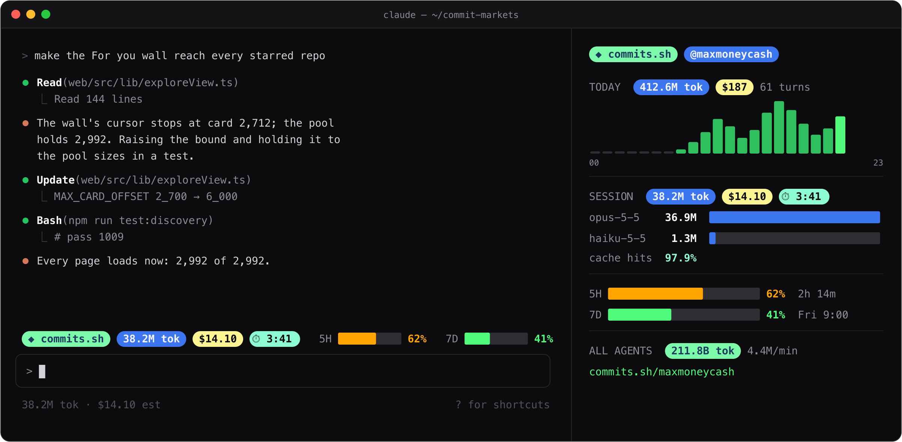

<p align="center">
  
</p>

<h1 align="center">commits.sh for Claude Code</h1>

<p align="center">Your token tape where the tokens are spent: live session tokens, estimated cost, the prompt-cache countdown and your limits, inside Claude Code.</p>

<p align="center">
  <a href="https://commits.sh"></a>
  
  
  <a href="LICENSE"></a>
</p>

## Install

At a Claude Code prompt:

```
/plugin install commits-sh --marketplace maxmoneycash/commits-sh-claude-code
```

Answer `y`, then pick the user scope to load it in every session. That's it: the band appears after your next turn.

<details>
<summary>From a shell, or the desktop app</summary>

```
claude plugin install commits-sh --marketplace maxmoneycash/commits-sh-claude-code
```

In the Claude desktop app: **+** next to the prompt box → **Plugins** → **Add marketplace** `maxmoneycash/commits-sh-claude-code` → **Add plugin**. A plugin installed at the user scope from a terminal also loads in the desktop app's Code tab.
</details>

## What you get

| | |
| --- | --- |
| **The band** | One row above the prompt in filled pills: commits.sh, session tokens, estimated dollars, the prompt-cache countdown (orange in its last minute, red once cold), then solid 5-hour and 7-day bars (green, orange past half, red past 80%) and today's total. Narrow terminals give up figures from the right; the session never goes. |
| **`/commits`** | A pane beside the chat: today's tokens by hour, the session by model with its cache hit rate, your 5-hour and 7-day limits with resets, and your commits.sh totals. |
| **Status line** | `38.2M tok · $14.10 est` for the session. |
| **The look** | `/commits theme on` gives the desktop app commits.sh's zinc and green, in light and dark. Off by default. |

## Commands

```
/commits                      open the pane
/commits connect <handle>     add your commits.sh figures
/commits disconnect
/commits theme on | off
/commits band on | off
```

## Data and privacy

- **Exact tokens.** Every count is the API's own usage for each request, subagents included. Dollars are Claude Code's estimate and say `est`.
- **Nothing leaves your machine** unless you connect a handle. Then the mod reads your public commits.sh pulse at most every five minutes, right after a turn. It never uploads anything.
- **Today** sums the sessions this mod ran in, kept in the mod's own store on your machine.

## Develop

```
claude --plugin-dir .        # run a session with this folder loaded
claude plugin test .         # the mod's tests
claude plugin validate .
```

MIT © [commits.sh](https://commits.sh)
